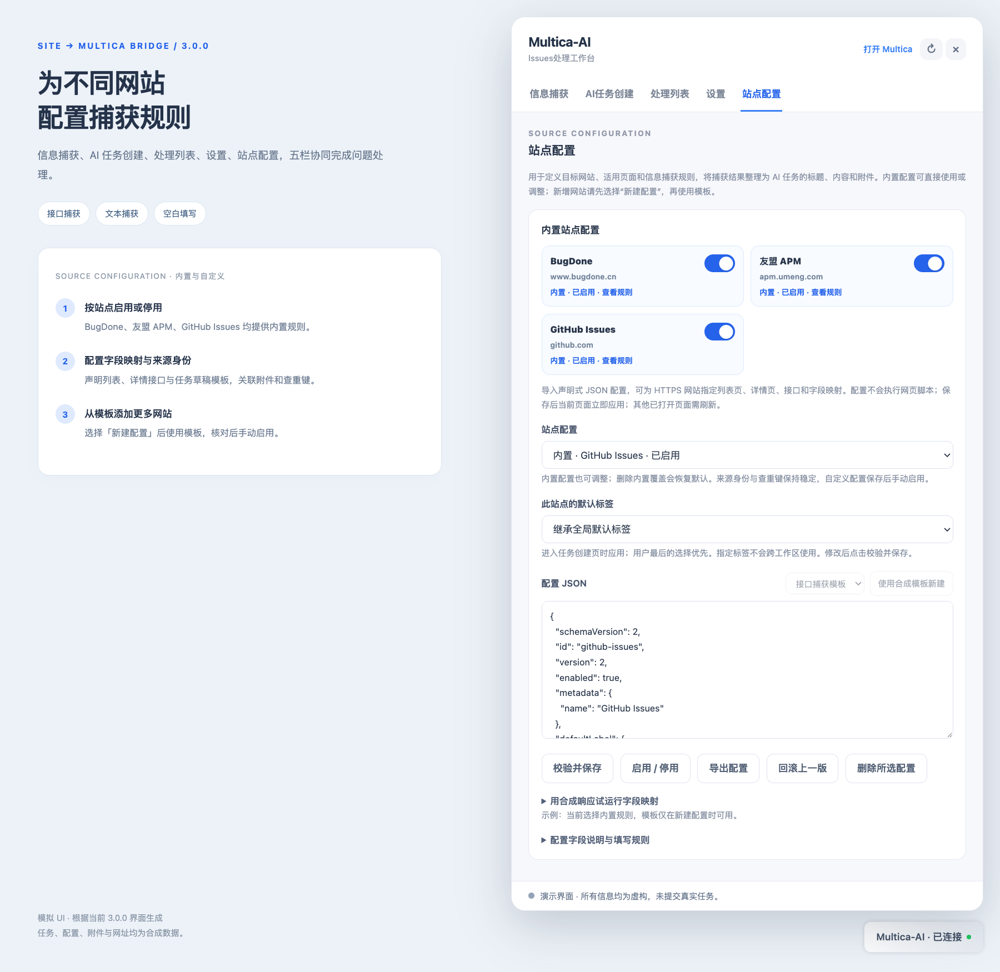
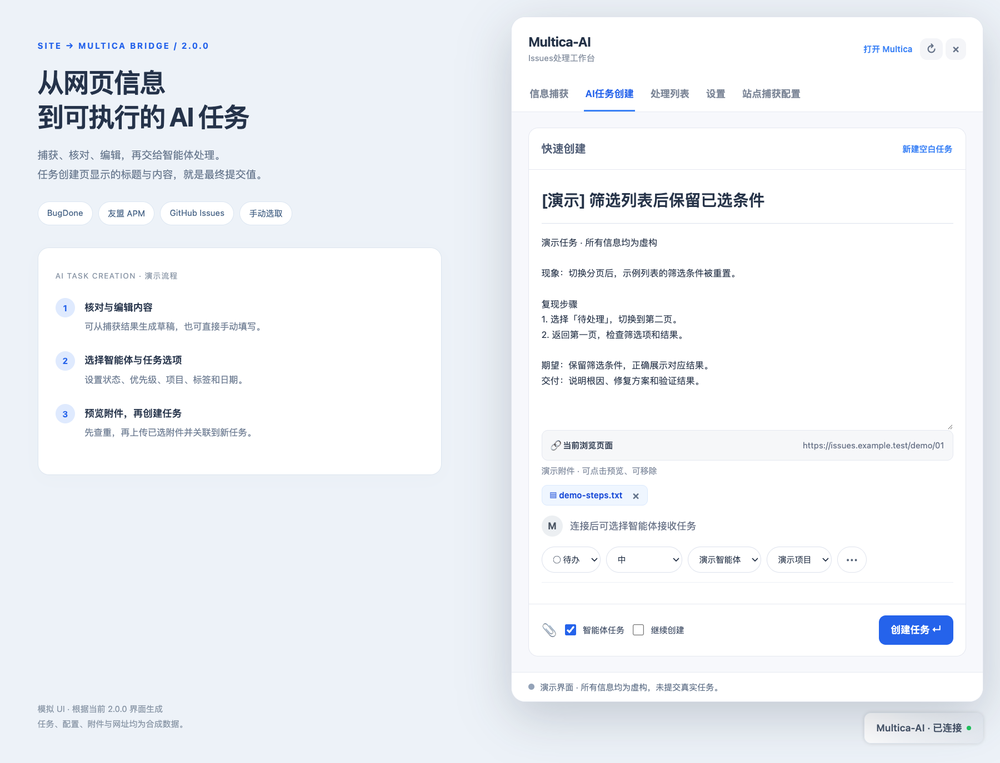
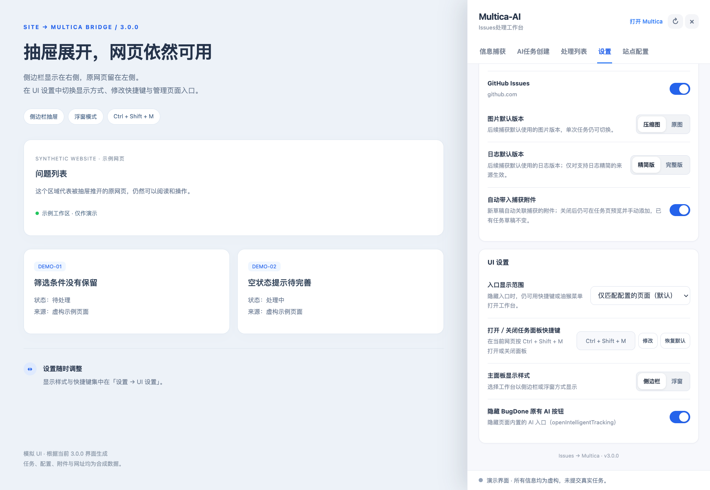

# Site → Multica Bridge

将网页问题整理成 Multica 任务并指派给智能体的油猴脚本。**v2.3.0** 支持 BugDone、友盟 APM、GitHub Issues，以及任意 HTTPS 网页的手动文字选取或直接填写任务；兼容 Tampermonkey 与提供原生桥的 FastlaneTool Mac WebView。

## 界面预览



当前工作台包含「信息捕获」「AI任务创建」「处理列表」「设置」「站点捕获配置」五栏。下方两张根据 2.0.0 用户脚本的 HTML/CSS 生成离线示例页，由 Ego Lite 渲染截图，分别展示通用任务创建、侧边栏抽屉与 UI 设置。任务、项目、智能体、附件和链接均为合成数据。





## 安装与升级

1. [安装最新版用户脚本](https://raw.githubusercontent.com/bosong/site-multica-bridge/main/bugdone-multica.user.js)。更新内容见 [CHANGELOG](./CHANGELOG.md)。
2. 在油猴中启用脚本并刷新目标网页，点击 **Multica-AI** 入口。按钮显示未配置、待连接、连接中、已连接或连接失败。
3. 在「设置 → 基础配置」选择官方 API 或添加自建服务器，填写 API Token，自动保存后点击“手动连接 / 刷新”验证并读取选项。再次打开匹配页面会按已保存配置自动连接，目录会缓存，手动刷新可重新读取。
4. 设置默认工作区、项目、智能体和可选标签。项目、标签和日期可以留空；明确清空的默认选项不会在刷新后自动选回第一项。各选项自动保存；令牌停止输入或失焦后保存，清空令牌及默认选项也会保存。
5. 在「信息捕获」核对来源、标题、内容与附件，点击底部固定的 **下一步：AI任务创建**。第二栏的最终标题、描述和任务选项就是提交值。

v2.0.0 的脚本名称为「Site 接入 Multica」，`@namespace` 改为 `local.site.multica`，`@description` 为「多站点信息捕获与 Multica 智能体任务桥接」，更新与下载 URL 指向新仓库。安装文件名仍为 `bugdone-multica.user.js`，使旧路径在仓库改名后仍能找到发布物；内部存储键和 BugDone 查重标记保持兼容，不随项目改名重置。

升级时建议在原有脚本编辑器中全选覆盖并保存，再刷新网页；不要同时启用新旧两份脚本。脚本管理器若把新名称/namespace 视为独立安装，其私有存储可能无法自动沿用，需要重新填写连接配置或导入已导出的站点规则。Mac 原生存储改用新 namespace；当原生桥已提供旧 namespace 数据时会迁移，当前网站旧本地值也会迁入新空间。桥未提供旧空间且没有本地副本时，需要重新配置，脚本不会绕过宿主的存储隔离。

## 入口显示范围

默认只在**匹配已启用配置的页面**显示悬浮入口。例如 GitHub 只在 Issues 列表与详情显示，代码页不显示。在「设置 → UI 设置 → 入口显示范围」可选择：

- **仅匹配配置的页面（默认）**：只有命中页面规则时自动显示。
- **所有 HTTPS 网页**：沿用原来的全站入口。
- **仅快捷键或菜单打开**：不自动显示悬浮入口。

未配置网页默认不挂载 UI、不自动连接 API、不安装网络捕获。随时可按 **Ctrl + Shift + M** 临时打开；支持油猴菜单 API 时也可从菜单打开工作台或入口设置。隐藏入口不会关闭已打开的面板或清空任务。新增配置与入口设置在当前页立即生效；其他已打开网页需刷新。

## 站点捕获

| 来源 | 捕获方式 | 附件与来源动作 |
| --- | --- | --- |
| BugDone | 观察已声明 BugAPI 的列表和详情响应 | 截图默认压缩，可切换原图；可配置新建成功后将待处理问题改为处理中 |
| 友盟 APM | 观察崩溃列表、详情、错误明细、行为日志和堆栈接口 | 堆栈默认精简 TXT，可切换完整版；提示已加载日志覆盖数量 |
| GitHub Issues | 以同源 GET 和 JSON 响应读取列表/详情 | 按仓库与 Issue 编号核对来源，保留正文 Markdown |
| 其他已配置网站 | 按 JSON 规则匹配页面、接口和字段 | 可配置文本、数组图片及独立 CDN 附件；新协议仍需可信适配器 |
| 文本/空白配置 | 按页面规则显示入口，使用文本模板或空白表单 | 不监听接口；只读取用户主动选区，可手动添加任务附件 |
| 未配置 HTTPS 网页 | 用户主动选取可见文字，或手动填写 | 不自动监听网络；仅对当前草稿防重复，以指纹提示可能重复 |

友盟从 `/error_analysis` 自动跳转到 `/crash` 时同步安装捕获，避免首个列表请求漏接；SPA 路由切换也会隔离旧页面的迟到响应。已配置站点可以选择「不关联问题 · 手动填写」，无需先捕获记录也能进入下一步。关联了问题的自动任务仍要求详情，避免把列表摘要当作完整内容。

模板下拉框与“使用合成模板新建”位于配置 JSON 输入框上方右侧，仅选择“新建配置”时启用；编辑内置或已有自定义配置时置灰，避免误覆盖。页面顶部提供功能说明。

「站点捕获配置」提供内置规则编辑、启停、恢复、JSON 导入/导出、合成样本试运行、变更范围提示和上一版回滚。扩大观察范围的配置更新会停用，需核对后重新启用。配置只声明规则，不接受任意 JavaScript、Cookie、令牌或任意写接口。

配置说明与参考：

- [配置字段指南](./doc/site-profile-guide.md)
- [BugDone JSON](./doc/site-profiles/bugdone.json)
- [友盟 APM JSON](./doc/site-profiles/umeng-apm-crash.json)
- [GitHub Issues JSON](./doc/site-profiles/github-issues.json)
- [文本捕获模板](./doc/site-profiles/example-text-page.json)与[空白填写模板](./doc/site-profiles/example-blank-page.json)
- [自定义站点模板](./doc/site-profiles/example-issues.json)与[合成响应](./doc/site-profiles/example-response.json)
- [设计基线](./doc/dynamic-capture-design.md)、[实施记录](./doc/multisite-implementation-plan.md)与[验收记录](./doc/local-acceptance.md)

## 创建任务与处理列表

- 创建顺序为：核验本地任务关联 → 分页精确查重 → 准备和上传附件 → 创建并指派任务。搜索失败或结果不确定时停止创建；超时后先核验，避免重复 POST。
- BugDone 保留旧 `[BugDone:<ID>]` 标记与缓存兼容；其他配置站点使用稳定的来源键和可见标记。删除可靠查重所需标记会阻止自动提交。手动任务没有业务 ID，不承诺跨设备强查重。
- 回形针支持选择本地文件；捕获与本地附件显示为可预览、可移除的条目。图片和 TXT 可点击查看；上传成功后通过 `attachment_ids` 关联，描述中的 URL 用于来源参考。读取或上传失败会停止创建。
- 友盟精简 TXT 默认最多两种堆栈、每种前 40 行；未打开的明细不会自动补齐。BugDone 压缩失败时提示错误，不暗中上传原图。
- 默认标签支持继承全局、不带标签或指定绑定 API/工作区的标签；任务创建页最后选择优先。标签通过 `label_ids` 提交，创建响应允许核对时会检查结果；复用已有任务不会自动补标签。
- BugDone 的 `postActions` 可关闭。启用时仅在新建 Multica 任务成功后重读问题状态，仍为待处理才更新为处理中并确认；复用已有任务或其他状态不会覆盖。回写失败单独提示，不把已创建任务误报为失败。
- 「处理列表」默认关联当前网页的来源站点，头部下拉菜单可切换其他配置站点或“全部站点”，并显示各站记录数。同站点内保留手动选择，切换到其他站点后优先关联新站点。
- 未配置网页按域名归类，停用或已删除配置的历史记录仍可查看。刷新只查询当前筛选内的任务状态；删除当前记录不会删除其他站点的历史。
- 「处理列表」最多保留 100 条，第 101 条淘汰最旧记录。可手动删除记录、查询或刷新 Multica 最新状态；切换到对应 API/工作区后才能查询其他环境的任务。
- 点击记录的“去详情页>”可在新标签页打开关联的原始问题或网页；BugDone 打开只读详情。旧记录可从内置站点来源标识恢复链接，信息不足的记录会禁用此入口。
- 「继续创建」会在本次成功后清空表单，方便输入下一项任务；智能体实际执行状态请到 Multica 查看。

## UI 与桌面程序

设置页头部显示自动保存状态，并提供“恢复偏好默认值”。确认后，任务默认工作区、项目和智能体恢复为已验证缓存中的首项（无缓存时等待连接），默认标签清空；面板样式、入口范围、快捷键、隐藏原有 AI 按钮及入口位置恢复安装默认值。

恢复时保留 API 地址、令牌、自建服务器列表、处理列表、站点捕获配置、附件和当前任务草稿内容。取消确认不会执行恢复。服务器或令牌修改后需手动连接验证；若存储降级为会话或页面内存，保存状态会明确说明。

在 UI 设置中可切换侧边栏抽屉与浮窗，入口按钮可拖动并记住位置；旧位置超出当前视口时自动移回窗口内，窗口缩放或按钮文字尺寸变化时也会检查边界。抽屉打开时推开原网页及配置的详情容器，关闭后恢复；默认快捷键 **Ctrl + Shift + M**，可修改或恢复默认。页面拥有键盘事件时可切换面板；焦点在浏览器地址栏等浏览器界面时，用户脚本无法接收快捷键。

「打开 Multica」尝试唤起已安装的桌面程序，未检测到切换时打开 [Multica 官网](https://multica.ai)。FastlaneTool 需支持 `multica://` 外部协议转发。

## Mac App WebView 与权限

没有 `GM_xmlhttpRequest` 时优先使用 `FastlaneNativeNetwork`；没有油猴存储时优先使用 `FastlaneNativeStorage`，再回退到当前网站的本地/会话存储。网页存储受站点隔离，跨站共享配置需要油猴存储或新版原生共享存储桥。

FastlaneTool 需提供与 `@fastlane-network`、`@fastlane-storage` 对应的原生桥，并按启用脚本的 `@connect` 授权网络目标。新版桥支持图片转传与大文件分块；旧桥对大于 1 MiB 的本地附件会提示更新。缺少桥时的网页 `fetch` 仍受目标 API 的 CORS 限制。FastlaneTool 原生代码位于独立项目，不包含在此脚本发布包中。

脚本可在 HTTPS 网页运行（`@match https://*/*`），悬浮入口按显示范围决定；只有启用且匹配页面的配置才观察指定接口。`@connect *` 用于用户选择的自建 Multica 服务和配置附件域，实际捕获与图片读取仍受配置校验。请勿在仓库、截图或 Issue 中提交 Token、Cookie、私有问题或日志。

## 本地检查

项目目录名为 `site-multica-bridge`。需要 Node.js，无第三方运行依赖，也无需构建：

```sh
npm run check
npm test
```

v2.0.0 发布检查：102 项自动化测试通过；Ego Lite 已验证 BugDone 列表、友盟列表及自动跳转、GitHub 列表/详情和隔离世界捕获。2026-10-27 用户确认全部验收完成。版本变化见 [CHANGELOG](./CHANGELOG.md)。

2.1.0 升级检查：114 项自动化测试通过，Ego Lite 已验证入口范围、延迟挂载、快捷键与菜单、文本/空白模板和跨页面草稿保留。

2.1.1 升级检查：118 项自动化测试通过，Ego Lite 已使用合成数据验证三个内置站点与手动任务的详情入口、旧记录降级和点击目标。

2.1.2 修复 BugDone 列表省略 ProjectId 时提交内容预览为空；仅从可信且匹配的项目页面补全身份。121 项测试通过，并在 Ego Lite 验证列表项切换与来源、摘要预览。

2.2.0 升级检查：127 项自动化测试通过。Ego Lite 离线运行完整脚本，验证自动保存、修改连接信息时不请求网络、取消/确认恢复、首项默认值及连接和用户数据保留。

2.3.0 升级检查：135 项自动化测试通过；Ego Lite 使用模拟记录验证站点默认关联、跨站切换、全部站点、未配置网页及单条删除隔离。
